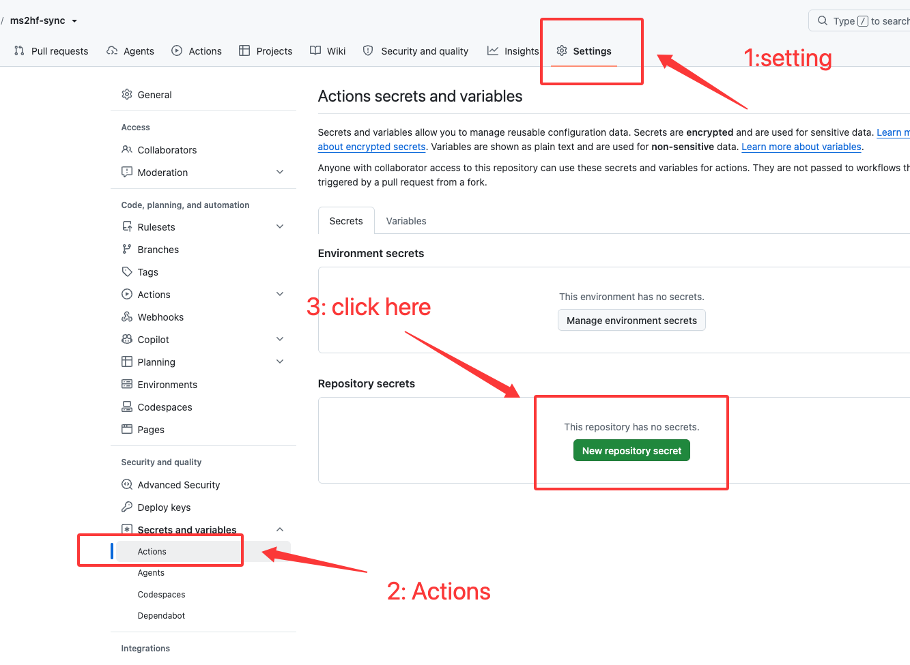
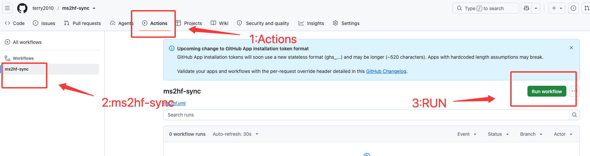

# ms2hf-sync

用 **GitHub Actions** 在 ModelScope 与 HuggingFace 之间**免代理**同步模型/数据集仓库。

```
本地(国内) ──直连上传──> ModelScope ──GitHub runner 中转──> HuggingFace
                                     ↑ 这一段走 GitHub 服务器带宽，
                                       不占本地流量、不需要代理
```

适合场景：国内网络直连 HuggingFace 困难，想把几十 GB 的模型发布到 HF；先把模型传到国内直连的 ModelScope，再让 GitHub 的机器替你把文件搬到 HF。反向（HF→MS）同样支持。

## 快速上手（fork 后 5 分钟开跑）

**① Fork 本仓库** → 右上角 *Fork*，建议保持 public（Actions 免费不限时；private 每月 2000 分钟额度）。

**② 配两个 secrets**——进入**你 fork 后的仓库页面**（不是个人设置）：
仓库顶部标签栏 **Settings**（Code/Issues 那一排最右侧）→ 左侧边栏 **Secrets and variables** → **Actions** → 绿色按钮 **New repository secret**，依次添加：



| Name | 值 | 在哪拿 |
|---|---|---|
| `HF_TOKEN` | `hf_xxx` | huggingface.co → Settings → Access Tokens（选 **write** 权限） |
| `MS_TOKEN` | `ms-xxx` | modelscope.cn → 个人中心 → 访问令牌 |

**③ 开启 Actions**——fork 来的仓库 Actions 默认是关的：点仓库顶部 **Actions** 标签 → 绿色按钮 *"I understand my workflows, go ahead and enable them"*。

**④ 跑一次**：*Actions → 左侧 ms2hf-sync → 右侧 Run workflow* → 填四个参数 → 点 **Run workflow**：



| 参数 | 填什么 | 示例 |
|---|---|---|
| direction | 下拉选同步方向 | `ModelScope → HuggingFace` |
| source_repo | 源仓库 `owner/name`（方向决定平台） | `Qwen/Qwen3-0.6B` |
| target_repo | 目标仓库 `owner/name` | `你的ID/Qwen3-0.6B` |
| repo_type | `model` 或 `dataset` | `model` |
| mirror | ⚠️ 镜像删除：同步后删除目标上源没有的文件 | 默认关闭 |
| force | 强制全量重传（默认已自动比对 sha256，一般不用开） | 默认关闭 |

**⑤ 看进度**：点进正在跑的 job → 展开 *Sync* 步骤，能看到每个文件的下载/上传实时进度。传完一个删一个，目标已有的自动跳过——**挂了直接再点一次 Run，已传的不重传**。

> 前置条件只有一个：**文件得先在源平台**。比如要发到 HF，先用 `modelscope upload` 把本地模型传到 MS（国内直连很快），剩下的交给 runner。

## 工作原理

底层调用 [`ms2hf`](https://github.com/pkufool/ms2hf)（PyPI 同名包）——**先比对再逐文件中继**：

```
1. 拉两边文件元数据（路径 / size / sha256），算出差异清单
2. 循环差异文件: 源平台下载 → 目标平台上传 → 删除本地文件 → 下一个
```

- **内容级增量**：LFS 文件两边都有 sha256，逐文件比 hash——同名同大小内容变了也能检出，只传变化的文件
- 无法比 hash 的小文件（&lt;100MB）直接重传（成本忽略）；无 hash 的大文件同大小会跳过并在日志警告
- **逐文件处理**，磁盘峰值 ≈ 并发数 × 最大单文件（不是整个仓库）
- 每传完一个文件即在目标落位 → 任务挂了重跑，已传的不重传
- 模型（model）和数据集（dataset）仓库都支持
- workflow 只用官方 CLI（`ms2hf`），token 不经过任何第三方 Action 代码

## 仓库差异对比（只读审计）

第二个 workflow **`仓库差异对比`**（`repo-diff.yml`）：只列两边文件比对，**不传输、不修改任何数据**——适合同步前预览「会传什么、会删什么」。

- 参数与同步 workflow 相同（direction / source / target / repo_type）
- 按 **sha256** 判定一致性，报告分五类：✅ 一致 / 🔶 内容不同 / 🔴 只在源仓（待传）/ 🟣 只在目标仓（mirror 会删）/ ⚪ 无法比对
- 报告是一张 `源 | 目标 | 结果` 三区表，渲染在 run 页面的 **Summary 卡片**里
- **同步 workflow 跑完会自动追加一个 verify job 跑同款对比**（即使同步失败/超时也跑），run 页面直接看到「同步后两边还差什么」
- 比对逻辑统一在 `scripts/compare.py`，两个 workflow 共用

建议节奏：**先跑一次对比 → 确认差异符合预期 → 再跑同步**；同步结束后看自动复检结果。

## 配置参数细节

workflow_dispatch 的六个输入项：

| 参数 | 说明 | 注意 |
|---|---|---|
| `direction` | 同步方向，决定 source/target 各是哪个平台 | `ms2hf`: 源=MS仓, 目标=HF仓；`hf2ms` 反之 |
| `source_repo` / `target_repo` | `owner/name` 格式 | 私有仓需要对应 token 有读/写权限 |
| `repo_type` | `model` / `dataset` | 两边类型保持一致 |
| `mirror` | 镜像删除开关 | 见下文 ⚠️ |
| `force` | 强制覆盖开关 | 见下文 |

### `mirror` 镜像删除（默认关闭，慎开）

默认模式是**并集同步**：只加不删，源删了文件目标不会跟着删。勾选 `mirror` 后变成**镜像同步**——文件传完后，删除目标仓里「源仓没有」的所有文件，目标最终与源逐文件一致。

- **不可逆**，被删文件只能从别处恢复
- 会删除目标上**手工上传的独有文件**：仅存在于 HF 的 README 修订、LICENSE、`.gitattributes` 等
- 源仓不完整时会误删——确认源是权威完整版再开
- 删除逐条打在 job 日志里（`mirror: deleting <path>`），可事后审计
- 建议流程：先不开镜像跑一遍同步 → 核对两边文件清单 → 再勾选补跑一次

### `force` 强制全量（默认关闭，通常不必开）

默认同步已经按 **sha256 比对**：缺失的、hash 不同的文件自动进入传输清单，未变的跳过——同名同大小内容变了也能检出。勾选 `force` 后跳过比对，**整仓全部重新下载+覆盖上传**。

- 适用场景：极少——比如怀疑 hash 元数据本身不可信、想强制刷新所有文件
- 代价：大仓要重下整个 20GB+，慢且没有收益，一般永远不用勾
- `force` + `mirror` 同勾 = **完全镜像**：全量覆盖 + 多余删除

并发控制：相同方向+源仓的任务同时只跑一个（`concurrency` 组），重复触发会排队而不是冲突。

## 限制与注意

| 项 | 限制 | 说明 |
|---|---|---|
| runner 磁盘 | ~14 GB | `--workers 2` 峰值 ≈ 2×最大单文件。**单文件 >6GB 把 `--workers` 改成 1** |
| 单 job 时长 | 6 h | 超时后重跑，已传文件自动跳过 |
| 并发提交 | HF 侧串行 | 多个任务同时推同一 HF 仓可能提交冲突，一次跑一个 |
| token 安全 | repo secrets | 不要写进 workflow 文件；public 仓 secrets 对 fork PR 不暴露 |
| 大仓预算 | public 免费 | private 每月 2000 分钟免费额度 |

## 常见问题

**Q: 目标仓库需要先建好 README 吗？**
不需要，ms2hf 只写文件。但 HF 侧建议先放好 `README.md`（模型卡）——文件到齐前页面对外是骨架状态。

**Q: ModelScope 建仓时报「名称含有敏感内容」？**
MS 对仓库名有审核词表（如 `abliterated`），换个中性名字即可，不影响文件内容。

**Q: 进度卡住不动？**
看日志定位是下载段（MS）慢还是上传段（HF）慢；MS 侧在凌晨通常更快。直接重跑，已完成的文件会跳过。

**Q: 想定时自动同步？**
在 `on:` 里加 schedule（cron），注意两个平台的源/目标会按方向互换。

## 文件说明

```
.github/workflows/ms2hf.yml      同步 workflow（sync job + 自动 verify 复检 job）
.github/workflows/repo-diff.yml  只读差异对比 workflow
scripts/compare.py               差异比对脚本（两个 workflow 共用）
README.md                     本文件
```

## License

MIT
